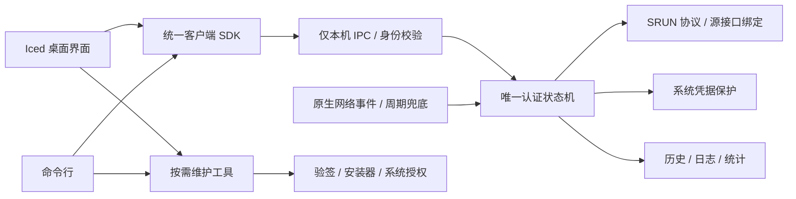

# 架构与安全边界

## 进程与统一接口

`bitnet-core` 定义 Command/Reply/Snapshot、配置、错误与退避策略，不能依赖 GUI 或操作系统。`bitnet-gateway` 提供单次有界 SRUN 操作。`bitnet-platform` 提供系统网络、路径、凭据和服务宿主。`bitnet-runtime` 持有唯一状态机、历史和本地 IPC；GUI 与 CLI 仅调用该接口，安装维护通过统一 maintenance API。

用户模式和系统模式共用引擎。客户端在系统服务已经安装时连接系统后台；服务不可用时不创建第二个用户控制器。共享后台允许本机用户管理账户、连接和自动认证，管理员可控制服务程序、认证目标与更新信任根。桌面启动与后台启动分别配置。

一个引擎串行处理认证和配置命令；状态读取使用发布的快照，避免被正在进行的 HTTP 请求阻塞。网络变化取消旧网络请求；每次绑定使用最新接口标识、IfIndex 和源 IPv4。查询出错不会被转换为未登录，已有其他账户在线不会自动被替换。登录和注销操作均复核真实状态。

Iced 使用 tiny-skia 软件渲染，关闭 wgpu，不依赖浏览器或 WebView。引擎使用单线程异步运行时，状态与外网健康分别检查；GUI 每两秒读取本地快照，不另起认证循环。后台单次响应、IPC 帧、等待队列、网络超时、日志、历史条数和下载均有上限。

进程数据目录锁避免同一实例重复启动。主动认证还按标准化网关 origin 与源 IPv4 组合争用本机认证域锁：Windows 使用显式跨用户权限的命名 mutex；Linux 使用内核 abstract AF_UNIX 地址占用，跨越 PrivateTmp；macOS 使用持有的 flock 文件，拒绝链接并核对 inode，释放时不删除。不同用户不会因个人数据目录不同而绕过同域排他。macOS 锁文件所有者恶意删除自身文件属于同身份恶意程序边界，真实跨用户测试尚未完成。

## 网络与凭据

网关默认 `http://10.0.0.55`。协议层兼容 SRUN JSONP，不执行 JSONP 脚本，不自行实现 HTTP。认证只向明确配置的网关发送，禁止认证重定向和隐式代理；单操作总 deadline 和响应上限防止挂起或无限内存增长。源接口绑定失败不退回默认路由。

自动认证额外要求用户确认当前网络。确认指纹由认证目标、接口、SSID、网关与源 IPv4 的 /24 网段组成；发生变化后重新确认。未知网络只查询，手动登录需要一次性确认。导入设置不能添加信任、清除手动暂停或清除密码拒绝标记。HTTP 网关没有加密身份认证，指纹是操作许可与误连接保护，不能防御能够完整仿冒局域网的攻击者。

可保存多个认证环境（网关、网卡、账户选择和规则），明确选择后生效。选择新认证目标不清除手动暂停；共享后台更改目标仍需管理员权限。网络规则按优先级解析，同优先级忽略规则优先，账户冲突时停止自动选择。

稳定在线时，认证查询间隔按 10、20、40 秒逐步增至用户上限；错误走独立的指数退避。网络事件与睡眠后时间间隔异常触发快速复查。外网 HTTP、多目标 DNS 和 IPv6 TCP 可达性仅供健康诊断，健康失败不会注销校园认证。持续在线统计只累计连续成功观测的区间，不把网关不可达时段当成已确认在线，不替代校方计费数据。

Windows 使用当前身份 DPAPI，系统服务要求固定 `NT SERVICE\BitNet` 身份。Linux 系统服务通过 systemd LoadCredential 获得 32 字节主密钥，再用成熟 AES-256-GCM 库加密账户集合；密钥只生成一次并保留，不能把 machine-id 当作秘密。Linux 桌面模式使用 Secret Service，缺失或锁定时提示修复而不保存明文。macOS 使用 Keychain，系统上下文与用户会话上下文隔离。

所有保存的密码只允许覆盖，不提供 GetPassword、通用解密或携带凭据的任意 HTTP 代理。Secret 的 Debug 永远脱敏；日志、诊断和 IPC 返回模型不包含密码、完整认证 URL、challenge 或 SRUN info。密码仅在加密存储和必要的请求期间使用。

用户身份的凭据保护不能阻止同一身份下的恶意程序。拥有完整管理员/root 权限、复制整个系统和密钥、绕过磁盘启动解锁不在保护目标内。

## 本地通信与磁盘

一次性登录由 `LoginOnce` 接收已确认网络指纹及临时凭据。引擎检查当前网关离线，要求本次提交成功且复查到目标账号在线。账户库、选中账户和自动认证设置保持原值。

门户发现优先访问配置网关。默认北理工网关未提供可识别的入口时，在同一接口绑定上向校站发送一次无凭据的探测，仅接受返回到配置网关的跳转。管理员可在网关配置设置请求 IPv4，值须匹配该会话观测 IP 或绑定接口地址。可选的哑终端注销限定同一会话的账号和网关观测地址，执行后复查离线。

Windows Named Pipe 拒绝远程连接、首实例占用、显式 DACL；普通客户端权限不包含创建服务端管道实例的位。发送秘密前核对系统服务 PID，用户模式核对服务端身份。调用者权限来自操作系统令牌，不相信消息中的用户名或 PID。

Unix 本地 socket 通过内核 peer credentials 验证身份；系统控制目录不可由普通用户写入。Linux 客户端核对服务进程的系统 cgroup。macOS 最终系统信任与 Keychain broker 的身份由原生签名要求约束；相关真实平台验收见 STATUS。

配置采用 schema version、revision 和原子替换；旧 revision 写入被拒绝。账户密文与非敏感配置分开。SQLite 仅保存事件和统计，保留期限与总条数有上限。升级、卸载保留数据时不得重新生成机器密钥或改服务身份。

结构日志包含级别、状态、脱敏网络指纹、重试次数和下次时间；保留期限与 5 MiB × 5 文件双重限额生效。系统模式尝试写 Windows Application Event Log，Unix 由服务管理器收集输出；持久文件与 SQLite 为主要诊断证据。数据库升级仅追加非敏感字段。

## 发布原则

默认用户安装免管理员；系统后台安装和升级按次授权。NSIS 编排两份不同作用域 MSI，MSI 是安装文件和服务的唯一归属方。更新需要可信项目签名和完整性验证，下载源不可用不影响现有认证。真实签名根、发布地址和 macOS 项目身份在正式发布前由维护者绑定，缺失时安全关闭更新，不能假报成功。
